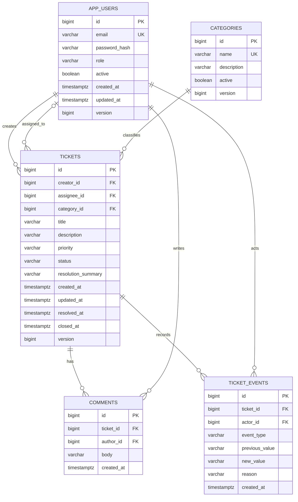
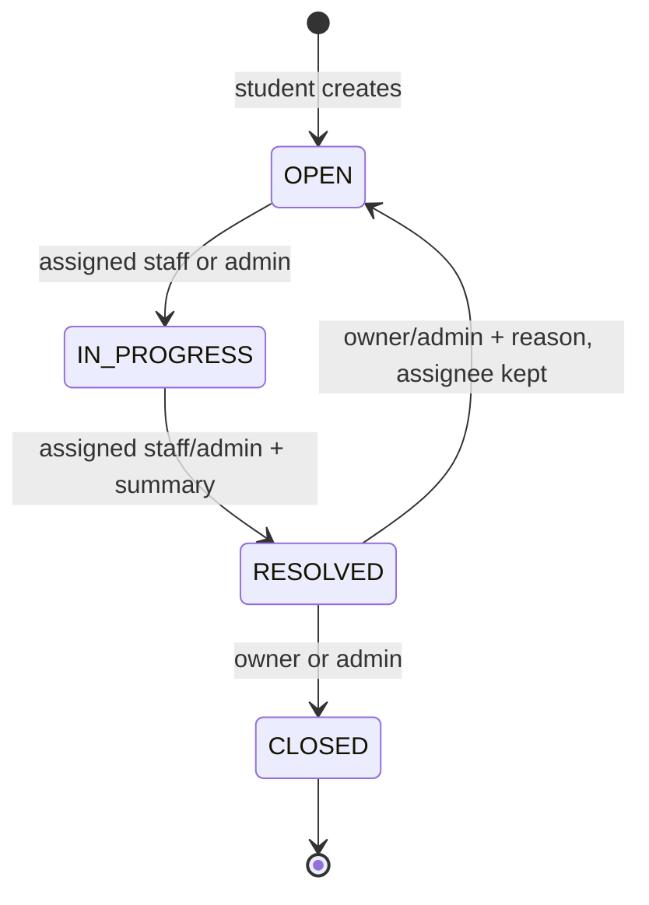

# Architecture

CampusDesk is a modular monolith: one process and one relational database, organized by feature (`auth`, `users`, `categories`, `tickets`, `common`). Ticket state and history need one reliable transaction; splitting them into services would add distributed consistency and operational complexity without a requirement.

The browser frontend is packaged as static Spring Boot resources with native JavaScript feature modules. It calls the API on the same origin, uses hash-based navigation, and requires no separate build/runtime service. Its role-specific controls are user experience aids; the backend remains the authorization authority. See `docs/frontend.md`.

Request flow: correlation filter → Spring Security bearer-token verification → current user lookup → controller DTO validation and coarse role check → transactional service with ticket visibility/lifecycle rules → Spring Data JPA → PostgreSQL. DTO mapping happens inside read transactions with Open Session in View disabled. Controllers never serialize persistence entities.

The ticket service owns assignment and status changes. The activity service owns comments/history reads and shares the ticket access rules. `TicketWorkflow` is a small pure rule component, not a generic state-machine framework. Repositories contain database access. Entity graphs fetch only many-to-one ticket/category/user data, never pageable collections. Comments and events are independently paginated.

Foreign keys prevent dangling references. Users and categories are deactivated, never deleted by the API. Unique normalized emails and a unique lower-case category-name index prevent duplicate identities. Database checks enforce valid role/priority/status and resolution/closure timestamp consistency. Flyway is schema authority; Hibernate only validates.

## Permissions

| Operation | Student | Staff | Admin |
| --- | --- | --- | --- |
| Create ticket | Yes, own | No | No |
| Ticket detail/list/comments/history | Own only | Assigned only | All |
| Add comment | Own, unless closed | Assigned, unless closed | Any, unless closed |
| Assign/reassign | No | No | Active staff; unless closed |
| Open → in progress | No | Assigned only | Any open ticket |
| In progress → resolved | No | Assigned; summary required | Summary required |
| Resolved → closed | Owner | No | Yes |
| Resolved → open | Owner; reason required | No | Reason required |
| Read active categories | Yes | Yes | Yes |
| Manage/list inactive categories | No | No | Yes |
| Create staff/manage users/statistics | No | No | Yes |

All roles require active accounts. Ticket ID access checks return identical 404 codes/details for inaccessible and absent tickets. Listing applies creator/assignee predicates to both results and counts. Deactivating staff immediately blocks their next protected request. Existing tickets retain the staff reference and appear to administrators until reassigned; ownership and historical attribution remain intact. Deactivated categories remain visible in historical ticket details but cannot be used for new tickets.

Assignment does not change status. All writes to an existing ticket require its current `version`. JPA also includes that version in the SQL update, catching races that occur after the request-level check. Comments touch the parent so a simultaneous closure/reassignment cannot commit a stale comment silently. Each operation saves state, comment (if applicable) and its event in one transaction; an error rolls everything back. Status/assignment updates flush before DTO mapping to return the incremented version. After commenting, reload the ticket to get its new version.

History records creation, assignment/reassignment, transitions, reopening and comment IDs. Resolution/reopen explanations are stored on events; old resolution summaries survive reopening in history. `@Immutable` plus a PostgreSQL trigger prevent event updates/deletes. This does not protect against a database owner dropping/truncating tables; production permissions and backups still matter.

Indexes follow visibility and order: `(creator_id, created_at DESC, id DESC)`, `(assignee_id, created_at DESC, id DESC)`, and `(status, created_at DESC, id DESC)`. Foreign-key/category and child ticket/time indexes support joins and activity reads. Literal case-insensitive title substring search escapes wildcard characters; it is not an indexed full-text search. `updatedAt` sorting may need a sort at larger scale. Offset pagination is intentionally bounded and deterministic within an unchanged dataset; concurrent inserts can move page boundaries.
